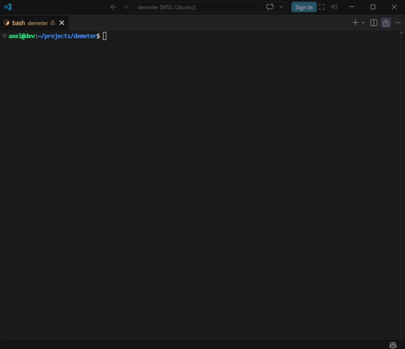
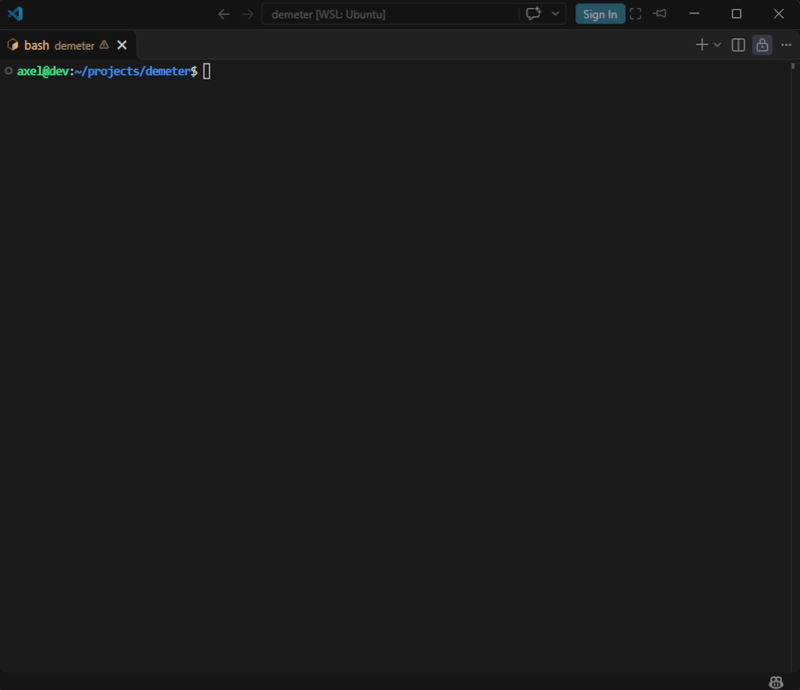

# Demeter Game – Reach the End, Outsmart the AI

## :book: Overview

A strategic board game developed in Python where players compete to reach the opposite side of the board before their opponent. The game supports both Player vs Player and Player vs AI game modes.

## :hammer_and_wrench: Skills Demonstrated

- Python Fundamentals
- Game Logic Implementation
- Basic Artificial Intelligence
- Algorithm Development
- Troubleshooting

## :rocket: Demo

### Gameplay Overview

The following demonstration showcases a typical game between a player and the AI, highlighting turn-based gameplay, move selection, and the progression toward the winning objective.

### IA Victory

The following demonstration showcases a complete game in which the AI successfully reaches the opposite side of the board first.

## :gear: Features

- Player vs Player
- Player vs AI
- Turn-Based Gameplay
- Strategic Movement System
- Win Condition Detection
- Move Tree Exploration
- AI evaluates all legal moves and selects the best strategy to maximize its chances of winning

## :video_game: How To Play

To start the game, simply run the main script:

`python demeter.py`

No installation or setup is required — just Python 3.x.